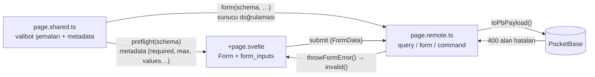
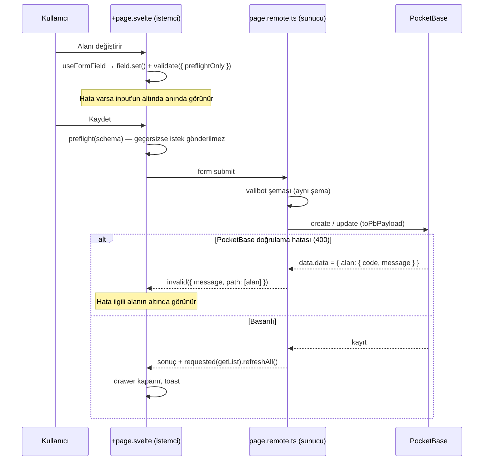

# Çekirdek Konsept (Core Concept)

Bu belge, projedeki **CRUD sayfa yapısını** anlatır. Yapı, SvelteKit **remote functions** (`query`, `form`, `command`) ile **PocketBase** koleksiyonlarını uçtan uca tip güvenli ve doğrulamalı biçimde birbirine bağlar.

Her sayfa üç dosyadan oluşur:

| Dosya            | Nerede çalışır   | Görevi                                                                   |
| ---------------- | ---------------- | ------------------------------------------------------------------------ |
| `page.shared.ts` | İstemci + sunucu | Alanların **tek doğruluk kaynağı**: valibot şemaları, kurallar, metadata |
| `page.remote.ts` | Sunucu           | `query` / `form` / `command` uç noktaları, PocketBase çağrıları          |
| `+page.svelte`   | İstemci          | Sayfa, tablo, drawer ve formlar                                          |

Örnek uygulama: [`src/routes/(app)/app/grapes/crud/simple/`](<../src/routes/(app)/app/grapes/crud/simple/>)

---

## İçindekiler

- [Temel ilkeler](#temel-ilkeler)
- [Genel akış](#genel-akış)
- [page.shared.ts: şemalar](#pagesharedts-şemalar)
- [Input builder'ları](#input-builderları)
- [Dosya alanı ve gölge alanlar](#dosya-alanı-ve-gölge-alanlar)
- [page.remote.ts: sunucu](#pageremotets-sunucu)
- [+page.svelte: sayfa](#pagesvelte-sayfa)
- [Form sarmalayıcıları (form_inputs)](#form-sarmalayıcıları-form_inputs)
- [Doğrulama katmanları ve hata mesajları](#doğrulama-katmanları-ve-hata-mesajları)
- [Yeni bir CRUD sayfası eklemek](#yeni-bir-crud-sayfası-eklemek)
- [Yeni bir input tipi eklemek](#yeni-bir-input-tipi-eklemek)
- [Kurallar ve tuzaklar](#kurallar-ve-tuzaklar)
- [Dosya haritası](#dosya-haritası)

---

## Temel ilkeler

1. **Şema tek doğruluk kaynağıdır.** Bir alanın zorunluluğu, uzunluk sınırı, seçenekleri, `multiple` olup olmadığı, ilişkili koleksiyonu ya da dosya kısıtları yalnızca `page.shared.ts` içinde yazılır. Hem istemci hem sunucu aynı şemayı kullanır.
2. **Sayfada yalnızca görünüm yazılır.** `+page.svelte` içinde bir input'a `label`, `text`, `placeholder`, `class` gibi görünüm prop'ları ve `field` / `value` verilir. Kurallar şemanın metadata'sından okunur.
3. **Seçenek adları PocketBase ile aynıdır.** `required`, `min`, `max`, `onlyInt`, `maxSelect`, `maxSize`, `mimeTypes` gibi. PocketBase panelinde ne görüyorsan şemaya aynısını yazarsın.
4. **"Zorunlu" PocketBase'deki anlamıyla kullanılır.**

   | Alan tipi                               | `required: true` iken |
   | --------------------------------------- | --------------------- |
   | Metin, e-posta, url, tarih, tekli seçim | Boş olamaz            |
   | Sayı                                    | 0 olamaz              |
   | Bool                                    | `true` olmalı         |
   | Çoklu seçim, çoklu dosya                | En az 1 öğe olmalı    |

   Boş değer (`''`, `0`, `[]`) için diğer kontroller (`min`, `max` vb.) atlanır; boşluğu yalnızca `required` kontrol eder.

5. **Doğrulama üç katmanlıdır.** Önce istemcide ön kontrol (preflight), sonra sunucuda valibot, en son PocketBase. Üç katmandan gelen hatalar da ilgili input'un altında, çevrilmiş olarak görünür.

---

## Genel akış



Bir kaydetme işleminin adımları:



---

## page.shared.ts: şemalar

Sayfanın tüm şemaları burada tanımlanır. Form şemaları, input builder'larının yayılmasıyla (`...input.X(...)`) kurulur:

```ts
import * as v from 'valibot';
import * as input from '#lib/app/schemas/inputs/index.js';
import { Collections } from '#lib/types/pocketbase-types.js';

export const createFormSchema = v.object({
	...input.Text('text_required'),
	...input.Text('text_optional', { required: false, max: 100 }),
	...input.Select('select_optional_multiple', { required: false, multiple: true, values: Object.values(DemoCrudSelectOptionalMultipleOptions) }),
	...input.Relation('relation_optional_single', { collection: Collections.DemoRelationInputSingle, required: false }),
	...input.File('file_optional_multiple', { required: false, multiple: true, maxSelect: 5, maxSize: 5 * 1024 * 1024, mimeTypes: ['image/png', 'image/jpeg'] }),
	...input.Bool('bool_optional'),
	...input.Number('number_optional', { required: false, min: 0, max: 100, onlyInt: true })
	// ...
});

// update = create + id
export const updateFormSchema = v.object({
	...input.Hidden('id'),
	...createFormSchema.entries
});

export const deleteParamsSchema = v.object({
	...input.Hidden('id')
});
```

Builder'lar bir nesne döndürür: `{ [key]: şema }`. `File` gibi bazı builder'lar birden fazla anahtar döndürür (bkz. [gölge alanlar](#dosya-alanı-ve-gölge-alanlar)). Bu yüzden şemaya hep `...` ile yayılarak eklenir.

Aynı dosyada liste ve tek kayıt sorgularının parametre şemaları (`listParamsSchema`, `oneParamsSchema`) da bulunur.

---

## Input builder'ları

Konum: [`src/lib/app/schemas/inputs/`](../src/lib/app/schemas/inputs/)

Her builder PocketBase'deki bir alan tipine karşılık gelir. Varsayılan olarak `required: true`'dur; Bool bunun tek istisnasıdır.

| Builder    | PocketBase alanı          | Seçenekler                                                                      | UI'a yansıması                              |
| ---------- | ------------------------- | ------------------------------------------------------------------------------- | ------------------------------------------- |
| `Text`     | Plain text                | `required`, `min`, `max` (varsayılan 255)                                       | `minlength`, `maxlength`                    |
| `Textarea` | Rich editor               | `required`, `maxSize` (**bayt**, varsayılan 1024)                               | —                                           |
| `Email`    | Email                     | `required`, `exceptDomains`, `onlyDomains`                                      | —                                           |
| `Url`      | URL                       | `required`, `exceptDomains`, `onlyDomains`                                      | —                                           |
| `Number`   | Number                    | `required`, `min`, `max`, `onlyInt`, `decimals`*                                | `min`, `max`, `step`                        |
| `Date`     | DateTime (yalnızca tarih) | `required`, `min`, `max` (`'YYYY-MM-DD'`)                                       | `min`, `max`                                |
| `Datetime` | DateTime                  | `required`, `min`, `max` (`'YYYY-MM-DDTHH:mm'`)                                 | `min`, `max`                                |
| `Bool`     | Bool                      | `required` (varsayılan **false**)                                               | zorunluluk yıldızı                          |
| `Select`   | Select                    | `required`, `multiple`, `values`, `maxSelect`                                   | seçenek listesi, `multiple`                 |
| `Relation` | Relation                  | `collection`, `required`, `multiple`, `minSelect`, `maxSelect`                  | koleksiyon, `multiple`                      |
| `File`     | File                      | `required`, `multiple`, `maxSelect`, `maxSize` (dosya başına bayt), `mimeTypes` | `accept`, `maxSize`, `maxCount`, `multiple` |
| `Hidden`   | —                         | `required`, `type: 'id' \| 'text'`                                              | —                                           |

\* `decimals` PocketBase'de yoktur; en fazla ondalık basamak sayısını sınırlar ve UI'daki `step` değerini belirler (`decimals: 2` → `0.01`).

Tüm builder'lar ayrıca `message` seçeneği alır. Bu, "zorunlu" hatasının mesajını değiştirir.

### Metadata (`InputMeta`)

Her builder, şemaya `inputMeta({...})` ile bir metadata ekler. Metadata `{ slc: InputMeta }` biçiminde saklanır:

```ts
// src/lib/app/schemas/inputs/meta.ts
export type InputMeta = {
	required: boolean;
	multiple?: boolean;
	min?: number;
	max?: number;
	onlyInt?: boolean;
	decimals?: number;
	minDate?: string;
	maxDate?: string;
	exceptDomains?: string[];
	onlyDomains?: string[];
	minSelect?: number;
	maxSelect?: number;
	maxSize?: number;
	mimeTypes?: string[];
	values?: string[]; // select değerleri
	collection?: string; // relation
};
```

Form sarmalayıcıları bu metadata'yı okuyarak zorunluluk yıldızını, `maxlength`, `min`/`max`, select seçeneklerini, relation koleksiyonunu ve `multiple` değerini kendisi ayarlar. Sayfada bunları tekrar yazmaya gerek kalmaz.

### Builder yazım kalıbı

Builder'lar aynı kalıbı izler: `v.optional(...)` ile varsayılan değer, ardından `v.check` ile kurallar, en sonda metadata:

```ts
const _Text = ({ required = true, min = 0, max = 255, message = errorKeys.required }: TextOptions = {}) =>
	v.pipe(
		v.optional(base.text, ''),
		v.check((input) => !required || input !== '', message),
		v.check((input) => input === '' || input.length >= min, errorKeys.minLength),
		v.maxLength(max, errorKeys.maxLength),
		inputMeta({ required, min, max })
	);

export function Text<Key extends string>(key: Key, options: TextOptions = {}) {
	return { [`${key}`]: _Text(options) } as { [P in Key]: ReturnType<typeof _Text> };
}
```

Hata mesajları metin değil **çeviri anahtarıdır** (`errorKeys.maxLength` → `'err_max_length'`). Bkz. [hata mesajları](#doğrulama-katmanları-ve-hata-mesajları).

`base.ts` içinde biçim kontrolleri bulunur (izin verilen karakterler, e-posta ve url biçimi, tarih ayrıştırma). Uzunluk ve boyut sınırları builder'larda verilir.

---

## Dosya alanı ve gölge alanlar

PocketBase'de dosya eklemek ve silmek için alan adına modifier eklenir: `alan+` ekler, `alan-` siler. Formda bunu karşılamak için `File` builder'ı **üç anahtar** üretir:

```ts
...input.File('documents', { multiple: true, maxSelect: 3, maxSize: 1024 * 1024, mimeTypes: ['application/pdf'] })
// → documents, documents_Plus, documents_Minus
```

| Anahtar           | İçerik                                            | Kontrol edilenler                                     | PocketBase'e                              |
| ----------------- | ------------------------------------------------- | ----------------------------------------------------- | ----------------------------------------- |
| `documents`       | Silinmeden kalan **ve** yeni eklenen dosya adları | `required`, toplam adet (`maxSelect`)                 | **gönderilmez** (transform → `undefined`) |
| `documents_Plus`  | Yeni seçilen `File` nesneleri                     | dosya başına `maxSize`, `mimeTypes`, yeni dosya adedi | `documents+`                              |
| `documents_Minus` | Silinecek kayıtlı dosya adları                    | —                                                     | `documents-`                              |

Önemli noktalar:

- **Ana alan yalnızca kontrol içindir.** Toplam adedi ve zorunluluğu kontrol edebilmek için kalan ve yeni dosya adlarını birlikte taşır. Bu liste istemciden geldiği için sunucuda kesin kontrolü PocketBase yapar.
- **Hatalar tek yerde görünür.** `_Plus` ve `_Minus` hataları (örneğin `documents_Plus.1: err_mime_type`) ana alanın altında gösterilir (`useFormField` → `shadowSuffixes`).
- **Tekli alanda değiştirme.** Yeni dosya seçilince kayıtlı dosya "silinecek" olarak işaretlenir (`_Minus`), yeni dosya `_Plus` ile gider. Listede eski dosya üstü çizili ve "Geri al" ile görünür.
- **Kayıtlı ve yeni dosya ayrı tutulur.** Bileşen içinde kayıtlı dosyalar `saved:`, yeni dosyalar `new:` önekli anahtarla saklanır. Aynı adı taşıyan yeni bir dosya kayıtlı olanın üstüne yazılmaz.
- **Boş dosya yok sayılır.** Seçilmemiş bir dosya inputunun gönderdiği boş `File` (ad `''`, boyut 0) ayıklanır.

Sunucuda bu anahtarlar `toPbPayload` ile PocketBase biçimine çevrilir (`_Plus` → `+`, `_Minus` → `-`).

---

## page.remote.ts: sunucu

```ts
import { getRequestEvent, query, form, command, requested } from '$app/server';
import { throwError, throwFormError, mapUnknownToError } from '#lib/server/error.js';
import { toPbPayload } from '#lib/utils/transform-params-helper.js';
import { listParamsSchema, oneParamsSchema, createFormSchema, updateFormSchema, deleteParamsSchema } from './page.shared';

export const getList = query(listParamsSchema, async (params) => {
	/* ... */
});
export const getOne = query(oneParamsSchema, async (params) => {
	/* ... */
});

export const createForm = form(createFormSchema, async (params) => {
	await checkAuthenticated(); // 🔒
	const { locals } = getRequestEvent();

	const createdResult = await ResultAsync.fromPromise(locals.pb.collection(Collections.DemoCrud).create(toPbPayload(params)), mapUnknownToError);
	if (createdResult.isErr()) {
		throwFormError(createdResult.error, params);
	}

	await requested(getList, 1).refreshAll();
	return createdResult.value;
});

export const updateForm = form(updateFormSchema, async (params) => {
	// ... update(params.id, toPbPayload(params, ['id'])) ...
});

export const deleteRecord = command(deleteParamsSchema, async (params) => {
	// ... delete(params.id); hata → throwError ...
});
```

### Yardımcılar

| Yardımcı                      | Konum                                                                             | Görevi                                                                                                                    |
| ----------------------------- | --------------------------------------------------------------------------------- | ------------------------------------------------------------------------------------------------------------------------- |
| `toPbPayload(params, omit?)`  | [`utils/transform-params-helper.ts`](../src/lib/utils/transform-params-helper.ts) | `omit` ile verilen anahtarları çıkarır (örn. `'id'`), `undefined` değerleri atar, `_Plus` / `_Minus` → `+` / `-` çevirir. |
| `throwFormError(err, params)` | [`server/error.ts`](../src/lib/server/error.ts)                                   | PocketBase **400** alan hatalarını `invalid()` ile ilgili alana yazar. Diğer hatalarda `throwError` davranışını uygular.  |
| `throwError(err)`             | [`server/error.ts`](../src/lib/server/error.ts)                                   | Hatayı SvelteKit `error()` olarak fırlatır; istemcide toast ile gösterilir.                                               |
| `checkAuthenticated()`        | [`remotes/guarded.remote.ts`](../src/lib/remotes/guarded.remote.ts)               | Oturum kontrolü 🔒                                                                                                        |

`throwFormError` hataları şöyle yönlendirir:

| PocketBase yanıtı                | Sonuç                                            |
| -------------------------------- | ------------------------------------------------ |
| 400, alan formda var             | İlgili alanın altında görünür                    |
| 400, `alan+` / `+alan` / `alan-` | Ana `alan` altında görünür (dosya alanları)      |
| 400, alan formda yok             | Form geneline yazılır: `alan: mesaj`             |
| 400, alan hatası yok             | PocketBase'in genel mesajı form geneline yazılır |
| 403, 404, 500 ve diğerleri       | `throwError` → toast                             |

### Ne zaman `form`, ne zaman `command`?

- **`form`**: Kullanıcının doldurduğu alanlar varsa (create, update). Doğrulama, alan hataları ve `enhance` buradan gelir.
- **`command`**: Alan olmayan, tek parametreli işlemler (delete, okundu işaretleme vb.). İstemcide `await deleteRecord({ id }).updates(query)` ile çağrılır.

Listeyi yenilemek için sunucuda `requested(getList, 1).refreshAll()`, istemcide `.updates(query)` kullanılır.

---

## +page.svelte: sayfa

### Form ve form örneği

```svelte
{#if drawerCommand.cmd === 'create'}
	<!-- .for(): drawer her açılışta temiz bir form örneği alır; kapanınca örnek (değerler, hatalar) silinir -->
	{@const form = createForm.for('create')}
	<DrawerFormContent.Content.Form
		enctype="multipart/form-data"
		schema={createFormSchema}
		{form}
		OnIsChange={(v) => (drawerFormIsChanged = v)}
		{...form.preflight(createFormSchema).enhance(({ submit }) => submitAndNotify(() => submit().updates(query)))}
	>
		{#snippet inputs()}
			{@render recordInputs(form.fields, {})}
		{/snippet}
		{#snippet buttons()}
			<formInput.Button type="submit" label={t('create')} disabled={Boolean(form.pending)} />
		{/snippet}
	</DrawerFormContent.Content.Form>
{:else if drawerCommand.cmd === 'update' && drawerCommand.id}
	{@const form = updateForm.for(drawerCommand.id)}
	<!-- ... aynı yapı; inputs içinde: -->
	<!-- <formInput.Hidden field={form.fields.id} value={dbData.id} /> -->
	<!-- {@render recordInputs(form.fields, dbData)} -->
{/if}
```

- **`schema`**: Form context'i sarmalayıcıların metadata'yı okuyabilmesi için şemayı alır.
- **`preflight(schema)`**: Gönderimden önce istemcide doğrulama yapar. Geçersizse istek gönderilmez.
- **`enctype="multipart/form-data"`**: Dosya alanı olan formlarda gereklidir.
- **`OnIsChange`**: Formda değişiklik olup olmadığını bildirir. Kaydedilmemiş değişiklik varsa drawer kapatılırken onay sorulur.

### `form.for(key)` neden gerekli?

`createForm` ve `updateForm`, `page.remote.ts` içinde modül düzeyinde **tek birer nesnedir**. Girilen değerler, hatalar ve "gönderildi" bilgisi bu nesnede tutulur. Drawer kapanıp form DOM'dan kalksa bile bu bilgiler kalır; tekrar açıldığında eski hatalar görünür.

`form.for(key)` her anahtar için ayrı bir örnek oluşturur. Örnek, onu kullanan bileşen DOM'dan kalkınca silinir. Bu sayede:

- Create drawer'ı her açılışta boş ve hatasız gelir.
- Her kaydın kendi update örneği olur; bir kayıttaki hata başka kayda taşınmaz.

> **Kural:** Drawer, modal ya da liste içinde açılıp kapanan formlarda `form.for(...)` kullan. Sayfada sürekli duran tek bir formda gerek yoktur.

### Ortak input listesi

Create ve update aynı alanları kullanır. Alanlar bir snippet'te bir kez yazılır:

```svelte
<!-- create ve update formlarının ortak inputları; kurallar page.shared.ts şemasından gelir -->
{#snippet recordInputs(fields: typeof createForm.fields, data: Partial<RecordType>)}
	<formInput.Text label="text_required" field={fields.text_required} value={data.text_required} />
	<formInput.Select label="select_optional_multiple" field={fields.select_optional_multiple} value={data.select_optional_multiple} />
	<formInput.Relation label="relation_optional_single" field={fields.relation_optional_single} value={data.relation_optional_single} />
	<formInput.File label="file_optional_multiple" field={fields.file_optional_multiple} value={data.file_optional_multiple} />
	<formInput.Bool label="bool_optional" text="Rahatsız Etmeyin" field={fields.bool_optional} value={data.bool_optional} />
	<!-- ... -->
{/snippet}
```

Dikkat edersen `multiple`, seçenekler, `collection`, `accept` gibi prop'lar yok; bunlar şemadan gelir.

### Gönderim akışı

```ts
const submitAndNotify = async (run: () => Promise<boolean>) => {
	try {
		if (await run()) {
			// başarılı: drawer kapanır, toast
		} else {
			// geçersiz veri: alan hataları inputların altında, ayrıca toast
		}
	} catch (error) {
		showError(error); // sunucu hatası (403, 500 …) → toast
	}
};
```

---

## Form sarmalayıcıları (form_inputs)

Konum: [`src/lib/components/ui/form_inputs/`](../src/lib/components/ui/form_inputs/)

İki katman vardır:

| Katman                   | Konum                        | Görevi                                                                                       |
| ------------------------ | ---------------------------- | -------------------------------------------------------------------------------------------- |
| **Input bileşenleri**    | `components/ui/inputs/`      | Saf UI: görünüm, etkileşim, `onValueChange`. Formdan bağımsızdır.                            |
| **Form sarmalayıcıları** | `components/ui/form_inputs/` | Input'u remote form alanına (`field`) bağlar; label, zorunluluk ve hata gösterimi (`Field`). |

### `useFormField`

[`form-field.svelte.ts`](../src/lib/components/ui/form_inputs/form-field.svelte.ts) içindeki `useFormField` yardımcısı tüm sarmalayıcıların ortak işini yapar:

```ts
const formField = useFormField(() => ({
	name: attributes.name, // field.as(...).name
	issues: field.issues(),
	label: componentLabel,
	shadowSuffixes: ['_Plus', '_Minus'] // yalnızca File
}));

formField.key; // şema anahtarı ('n:', 'b:' öneki ve '[]' temizlenmiş)
formField.meta; // InputMeta
formField.required; // meta.required
formField.label; // verilen label ya da alan adı
formField.issues; // çevrilmiş hatalar (+ gölge alan hataları)
formField.track(value, initial); // form context'ine yazar (isChanged hesabı)
formField.validate(); // preflight doğrulaması
```

Basit bir sarmalayıcı (Text):

```svelte
<script lang="ts">
	let { label: componentLabel, field, onValueChange: userOnValueChange, ...restProps }: Props = $props();

	let attributes = $derived(field.as('text'));
	const formField = useFormField(() => ({ name: attributes.name, issues: field.issues(), label: componentLabel }));

	const onValueChange = (args: TextValueChangeArgs) => {
		formField.track(args.value, args.initial);
		field.set(args.value);
		userOnValueChange?.(args);
		formField.validate();
	};
</script>

<Field issues={formField.issues} required={formField.required} label={formField.label} {id}>
	<Text {id} name={attributes.name} minlength={formField.meta.min || undefined} maxlength={formField.meta.max} {onValueChange} {...restProps} />
</Field>
```

### Öncelik: prop > metadata

Metadata'dan gelen öznitelikler (`maxlength`, `min`, `options`, `collection`, `accept` …) `{...restProps}` spread'inden **önce** verilir. Böylece sayfada açıkça verilen prop şemadakini ezer.

### `onValueChange` ayrı alınır

Kullanıcının verdiği `onValueChange`, `restProps`'tan ayrılarak `userOnValueChange` adıyla alınır. Aksi halde spread sarmalayıcının kendi handler'ını ezer ve alan formla bağını kaybeder (`field.set` çalışmaz).

### `multiple` olan sarmalayıcılar (Select, Relation, File)

- Generic tip `field` üzerinden çıkarılır: `generics="T extends string | string[] = string"`. Sayfada `multiple` yazılmaz.
- `multiple` çalışma anında metadata'dan okunur.
- Şema anahtarı `multiple` bilinmeden bulunur: `field.as('select')` ile `field.as('select multiple')` adları yalnızca `[]` ile ayrılır.

---

## Doğrulama katmanları ve hata mesajları

| Katman                  | Ne zaman                                                             | Nerede görünür                        |
| ----------------------- | -------------------------------------------------------------------- | ------------------------------------- |
| **İstemci ön kontrolü** | Alan değiştiğinde ve gönderimden önce (`preflight`)                  | Input'un altında, anında              |
| **Sunucu (valibot)**    | Form sunucuya ulaştığında; istemci atlatılsa bile                    | Input'un altında                      |
| **PocketBase**          | Kayıt sırasında (benzersizlik, ilişki varlığı, toplam dosya adedi …) | `throwFormError` ile input'un altında |

### Çeviri anahtarları

Dil yalnızca istemcide bilindiği için (`localStorage`) mesajlar sunucuda çevrilmez. Mesaj olarak bir **anahtar** taşınır ve istemcide çevrilir:

```ts
// şema
v.maxLength(max, errorKeys.maxLength); // 'err_max_length'

// çeviri (src/lib/app/localization/translations/tr.ts)
err_max_length: ('Lütfen en fazla {max} karakter girin.',
	// istemci (useFormField)
	t(issue.message, metaParams(meta), issue.message));
// → "Lütfen en fazla 100 karakter girin."
```

- `{min}`, `{max}`, `{maxSelect}` gibi parametreler alanın **metadata'sından** doldurulur.
- `{maxSizeText}` otomatik eklenir: `maxSize` değerinin okunabilir hâli ("1 MB").
- `t(key, params, fallback)`: Anahtar bulunamazsa `fallback` gösterilir. Böylece çeviri anahtarı olmayan mesajlar (örn. `base.ts` içindeki biçim hataları ya da PocketBase'in kendi mesajları) olduğu gibi görünür.

PocketBase hata kodları sunucuda anahtara çevrilir (`throwFormError`):

| PocketBase kodu                  | Anahtar              |
| -------------------------------- | -------------------- |
| `validation_required`            | `err_required`       |
| `validation_not_unique`          | `err_not_unique`     |
| `validation_min_text_constraint` | `err_min_length`     |
| `validation_max_text_constraint` | `err_max_length`     |
| diğerleri                        | PocketBase'in mesajı |

Belirli bir alana ait olmayan hatalar `Form` bileşeninde inputların altında, kırmızı bir kutuda gösterilir.

---

## Yeni bir CRUD sayfası eklemek

1. **PocketBase'de koleksiyonu oluştur** ve tipleri güncelle (`src/lib/types/pocketbase-types.ts`).
2. **`page.shared.ts`** — alanları PocketBase'deki ayarlarla aynı seçeneklerle tanımla:
   ```ts
   export const createFormSchema = v.object({
   	...input.Text('title', { max: 120 }),
   	...input.Number('price', { min: 0, decimals: 2 }),
   	...input.Select('status', { values: ['draft', 'published'] }),
   	...input.File('cover', { required: false, maxSize: 2 * 1024 * 1024, mimeTypes: ['image/png', 'image/jpeg'] })
   });
   export const updateFormSchema = v.object({ ...input.Hidden('id'), ...createFormSchema.entries });
   export const deleteParamsSchema = v.object({ ...input.Hidden('id') });
   ```
3. **`page.remote.ts`** — `getList`, `getOne`, `createForm`, `updateForm`, `deleteRecord`. Her birinde `checkAuthenticated()`, PocketBase çağrısında `toPbPayload`, hatada `throwFormError` (form) ya da `throwError` (query/command).
4. **`+page.svelte`**:
   - `recordInputs` snippet'inde her alan için bir `formInput.X` (yalnızca `label`, `field`, `value`).
   - Drawer içinde `createForm.for('create')` ve `updateForm.for(id)`.
   - `preflight(schema).enhance(...)` ile `submitAndNotify`.
5. **Dene:** Her kısıt için istemci hatası, istemci atlatıldığında sunucu hatası ve PocketBase hatası ayrı ayrı görünmeli.

---

## Yeni bir input tipi eklemek

1. **Input bileşeni** — `components/ui/inputs/X.svelte`: saf UI, `value` + `onValueChange({ value, beforeValue, initial })`. Prop tipleri `inputs/type.d.ts` içinde.
2. **Builder** — `app/schemas/inputs/x.ts`: PocketBase seçenekleri, `v.optional` + `v.check` + `inputMeta(...)`. Gerekirse `InputMeta` tipine yeni alan ve `errorKeys`'e yeni anahtar ekle; `inputs/index.ts`'ten dışa aktar.
3. **Çeviri** — yeni `err_*` anahtarlarını `tr.ts` ve `en.ts` dosyalarına ekle.
4. **Sarmalayıcı** — `components/ui/form_inputs/X.svelte`: `useFormField` ile bağla, metadata'dan gelen öznitelikleri spread'den önce ver; `form_inputs/index.ts`'ten dışa aktar.

---

## Kurallar ve tuzaklar

- **Diziler için `v.fallback` kullanma, `v.optional` kullan.** `fallback` geçersiz değeri hata vermeden varsayılana çevirir; örneğin geçersiz bir select değeri sessizce `[]` olur ve kayıttaki veri silinir.
- **Bool alanlar şemada optional olmalı** (`v.optional(v.boolean(), false)`). İşaretlenmemiş checkbox hiçbir değer göndermez; SvelteKit bunu zorunlu kılar.
- **Zorunlu alanlarda da `v.optional(x, '')` kullan.** Anahtar hiç gönderilmezse valibot "Invalid type" yerine `err_required` döner.
- **Builder fonksiyonu global bir adı gölgeleyebilir.** `Number` builder'ı içinde `Number.isInteger` modüldeki builder'ı çağırır; `Math.trunc(x) === x` gibi alternatifler kullan. (`Date` için de aynı durum geçerlidir.)
- **Remote form alan adları önek taşır.** Sayı alanları `n:`, bool alanları `b:` ile başlar, diziler `[]` ile biter. Şema anahtarı için `useFormField().key` (ya da `fieldKeyFromName`) kullan.
- **Tarih değerleri UTC olarak saklanır.** Input'tan gelen değer UTC kabul edilir (`parseDateInputToIso`, `parseDatetimeInputToIso`). `min` / `max` input biçiminde verilir ve karşılaştırma ISO metinleri üzerinden yapılır.
- **`Textarea` sınırı bayt cinsindendir.** Türkçe karakterler 2 bayt tutar; karakter sayısıyla kontrol yanlış sonuç verir.
- **Açılıp kapanan formlarda `form.for(key)` kullan.** Aksi halde eski değerler ve hatalar sonraki açılışta görünür.

---

## Dosya haritası

```text
src/
├── lib/
│   ├── app/
│   │   ├── localization/
│   │   │   ├── localization.svelte.ts      # t(key, params, fallback)
│   │   │   └── translations/{tr,en}.ts     # err_* anahtarları
│   │   └── schemas/
│   │       ├── base.ts                     # biçim kontrolleri (karakter, e-posta, url, tarih)
│   │       └── inputs/
│   │           ├── meta.ts                 # InputMeta, inputMeta(), errorKeys, domainAllowed
│   │           ├── text.ts  textarea.ts  email.ts  url.ts
│   │           ├── number.ts  date.ts  datetime.ts  bool.ts
│   │           ├── select.ts  relation.ts  file.ts  hidden.ts
│   │           └── index.ts
│   ├── components/ui/
│   │   ├── inputs/                         # saf UI input bileşenleri
│   │   └── form_inputs/
│   │       ├── Form.svelte                 # form + context + form geneli hatalar
│   │       ├── Field.svelte                # label, zorunluluk yıldızı, hatalar
│   │       ├── context.svelte.ts           # şema, initialData/currentData, isChanged
│   │       ├── form-field.svelte.ts        # useFormField
│   │       └── Text.svelte  Select.svelte  File.svelte  ...
│   ├── server/error.ts                     # throwError, throwFormError
│   └── utils/
│       ├── transform-params-helper.ts      # toPbPayload
│       └── input-helper.ts                 # tarih dönüşümleri, formatBytes
└── routes/(app)/app/grapes/crud/simple/
    ├── page.shared.ts
    ├── page.remote.ts
    └── +page.svelte
```
